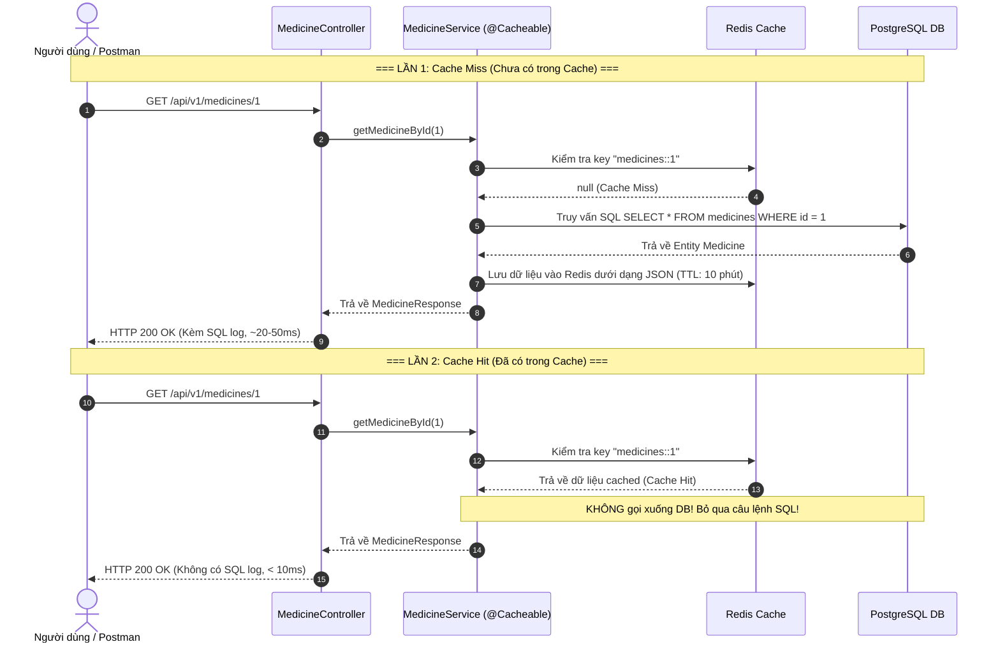

# [Bài tập] Caching Danh Mục Thuốc (Redis Cache)

Hệ thống quản lý và Caching danh mục thuốc dành cho hiệu thuốc lớn, áp dụng cơ chế **Cache-aside pattern** với **Spring Boot 3.3.5**, **Spring Data Redis**, và cơ sở dữ liệu **PostgreSQL**.

---

## 1. Mục tiêu bài thực hành
- **Kiến thức**: Nắm vững cơ chế hoạt động của Cache-aside pattern, hiểu cách Redis lưu trữ dữ liệu dạng Key-Value (JSON format với Serializer).
- **Kỹ năng**: Cài đặt Redis trên môi trường phát triển, cấu hình `spring-boot-starter-data-redis` và `spring-boot-starter-cache`.
- **Yêu cầu kỹ thuật**:
  - Cấu hình Redis làm Cache Provider trong `application.properties`.
  - Sử dụng annotation `@Cacheable(value = "medicines", key = "#id")` tại phương thức lấy chi tiết thuốc.
  - Sử dụng `@CachePut` khi cập nhật thuốc và `@CacheEvict` khi xóa thuốc để đảm bảo tính nhất quán dữ liệu (Cache Invalidation).
  - Kiểm chứng: Gọi API lấy thuốc lần 1 (log hiển thị câu lệnh SQL), gọi lần 2 (log không hiện SQL, thời gian phản hồi cực nhanh `< 10ms`).

---

## 2. Kiến trúc & Sơ đồ Luồng Cache-aside Pattern



---

## 3. Cấu trúc Dự án (Clean Layered Architecture)

```
buoi11/
├── src/main/java/com/medical/medicine/
│   ├── MedicineServiceApplication.java      # Main Application (@SpringBootApplication)
│   ├── config/
│   │   ├── RedisConfig.java                 # Cấu hình Redis Cache Manager, Json Serializer & TTL
│   │   ├── DataInitializer.java            # Khởi tạo dữ liệu mẫu thuốc vào DB khi chạy lần đầu
│   │   └── OpenApiConfig.java              # Cấu hình Swagger OpenAPI UI
│   ├── controller/
│   │   └── MedicineController.java          # REST API Endpoints (/api/v1/medicines)
│   ├── dto/
│   │   ├── request/MedicineRequest.java     # Request DTO (Java record + Jakarta Validation)
│   │   └── response/
│   │       ├── MedicineResponse.java        # Response DTO (Java record + Serializable)
│   │       └── ApiResponse.java             # Chuẩn hóa Response Wrapper
│   ├── entity/
│   │   └── Medicine.java                    # Entity ánh xạ bảng `medicines`
│   ├── exception/
│   │   ├── ResourceNotFoundException.java   # Ngoại lệ 404
│   │   ├── DuplicateResourceException.java  # Ngoại lệ 409
│   │   ├── ErrorResponse.java               # DTO định dạng lỗi thống nhất
│   │   └── GlobalExceptionHandler.java      # @RestControllerAdvice tập trung
│   ├── mapper/
│   │   └── MedicineMapper.java              # Ánh xạ Entity <-> DTO
│   ├── repository/
│   │   └── MedicineRepository.java          # Spring Data JPA Repository
│   └── service/
│       ├── MedicineService.java             # Interface Service
│       └── impl/MedicineServiceImpl.java    # Implementation (@Cacheable, @CachePut, @CacheEvict)
├── src/main/resources/
│   └── application.properties               # Cấu hình DataSource, Redis Cache Provider, SQL Logging
├── src/test/java/com/medical/medicine/
│   ├── service/MedicineServiceTest.java     # Unit test Service với Mockito
│   ├── controller/MedicineControllerTest.java # Slice test Controller (@WebMvcTest)
│   └── MedicineCacheIntegrationTest.java    # Integration test kiểm chứng Cache-aside logic
├── start-redis.bat                          # File chạy Redis Server nhanh
├── start-postgres.bat                       # File chạy PostgreSQL Server nhanh
├── redis-cli.bat                            # File mở nhanh Redis CLI
├── build.gradle / pom.xml                   # Hỗ trợ cả Gradle và Maven
└── README.md
```

---

## 4. Cấu hình Cốt lõi

### 4.1. File `application.properties`
```properties
# Server
server.port=8080

# PostgreSQL Database
spring.datasource.url=jdbc:postgresql://localhost:5432/medicine_db
spring.datasource.username=postgres
spring.datasource.password=123456
spring.jpa.hibernate.ddl-auto=update

# Bật log SQL để kiểm chứng caching
spring.jpa.show-sql=true
spring.jpa.properties.hibernate.format_sql=true
logging.level.org.hibernate.SQL=DEBUG
logging.level.org.hibernate.orm.jdbc.bind=TRACE

# Cấu hình Redis làm Cache Provider
spring.cache.type=redis
spring.data.redis.host=localhost
spring.data.redis.port=6379
spring.data.redis.timeout=60000ms

# Cài đặt TTL Cache (10 phút = 600000ms)
spring.cache.redis.time-to-live=600000
spring.cache.redis.cache-null-values=false
spring.cache.redis.use-key-prefix=true
spring.cache.redis.key-prefix=medicines::
```

### 4.2. Khai báo `@Cacheable` trong `MedicineServiceImpl.java`
```java
@Override
@Cacheable(value = "medicines", key = "#id")
public MedicineResponse getMedicineById(Long id) {
    log.info("--> [CACHE MISS / DB QUERY] Dang truy van thong tin thuoc tu PostgreSQL Database voi ID = {}", id);

    Medicine medicine = medicineRepository.findById(id)
            .orElseThrow(() -> new ResourceNotFoundException("Khong tim thay thuoc voi ID: " + id));

    return medicineMapper.toResponse(medicine);
}
```

### 4.3. Cấu hình Tuần tự hóa JSON trong `RedisConfig.java`
Dữ liệu thuốc được tuần tự hóa dạng JSON có kèm type metadata, giúp:
1. Đọc và gỡ lỗi trực quan trên Redis (`redis-cli`, Redis Insight).
2. Tương thích an toàn tuyệt đối với Java `record` (`MedicineResponse`).

---

## 5. Hướng dẫn Khởi chạy & Kiểm thử

### Bước 1: Khởi động Redis & PostgreSQL
1. Chạy file `start-redis.bat` (hoặc khởi động dịch vụ Redis trên port 6379).
2. Chạy file `start-postgres.bat` (hoặc khởi động dịch vụ PostgreSQL trên port 5432).

### Bước 2: Chạy ứng dụng Spring Boot
Mở Terminal tại thư mục dự án và chạy:
```powershell
# Bằng Gradle Wrapper
.\gradlew.bat bootRun

# Hoặc bằng Maven
mvn spring-boot:run
```

*Khi ứng dụng khởi động thành công, `DataInitializer` sẽ tự động chèn 7 loại thuốc mẫu (Panadol Extra, Paracetamol 500mg, Amoxicillin 500mg, Decolgen Forte, Berberin 100mg, Omeprazole 20mg, Cetirizine 10mg) vào Database.*

---

## 6. Thực hành Kiểm chứng Caching

### 6.1. Gọi API Lần 1 (Cache Miss)
Thực hiện request:
```http
GET http://localhost:8080/api/v1/medicines/1
```
- **Kết quả trên Console**:
  ```text
  INFO  : --> [CACHE MISS / DB QUERY] Dang truy van thong tin thuoc tu PostgreSQL Database voi ID = 1
  DEBUG : org.hibernate.SQL : 
      select m1_0.id, m1_0.category, m1_0.code, m1_0.created_at, m1_0.description, m1_0.dosage, m1_0.manufacturer, m1_0.name, m1_0.price, m1_0.updated_at 
      from medicines m1_0 where m1_0.id=?
  TRACE : binding parameter (1:BIGINT) <- [1]
  ```
- **Thời gian phản hồi**: ~20ms - 50ms (do phải kết nối và query PostgreSQL).

### 6.2. Kiểm tra dữ liệu được lưu trong Redis
Mở file `redis-cli.bat` hoặc gõ terminal:
```bash
redis-cli
127.0.0.1:6379> KEYS *
1) "medicines::1"

127.0.0.1:6379> GET "medicines::1"
"{\"@class\":\"com.medical.medicine.dto.response.MedicineResponse\",\"id\":[\"java.lang.Long\",1],\"name\":\"Panadol Extra\",\"code\":\"MED-001\",\"category\":\"Giam dau - Ha sot\",\"price\":[\"java.math.BigDecimal\",25000.00],\"dosage\":\"Paracetamol 500mg, Caffeine 65mg\",\"description\":\"Thuoc giam dau, ha sot...\",\"manufacturer\":\"GlaxoSmithKline (GSK)\",...}"
```
Dữ liệu thuốc đã được lưu vào Redis dưới dạng JSON chuẩn xác!

### 6.3. Gọi API Lần 2 (Cache Hit)
Thực hiện lại request với cùng ID:
```http
GET http://localhost:8080/api/v1/medicines/1
```
- **Kết quả trên Console**: **HOÀN TOÀN KHÔNG CÓ LOG SQL**, hàm service không bị gọi xuống Database.
- **Thời gian phản hồi**: **~2ms** (Đạt chuẩn `< 10ms` theo yêu cầu bài thực hành).

---

## 7. Danh sách API Endpoints

| Phương thức | Endpoint | Mô tả | Caching |
|---|---|---|---|
| `GET` | `/api/v1/medicines/{id}` | Lấy chi tiết thuốc theo ID | `@Cacheable(value = "medicines", key = "#id")` |
| `GET` | `/api/v1/medicines` | Lấy toàn bộ danh mục thuốc | - |
| `POST` | `/api/v1/medicines` | Thêm mới một loại thuốc | - |
| `PUT` | `/api/v1/medicines/{id}` | Cập nhật thông tin thuốc | `@CachePut(value = "medicines", key = "#id")` |
| `DELETE`| `/api/v1/medicines/{id}` | Xóa thuốc khỏi hệ thống | `@CacheEvict(value = "medicines", key = "#id")` |

**Swagger UI Documentation**: Truy cập trực tiếp tại:
👉 `http://localhost:8080/swagger-ui.html`

---

## 8. Chạy Tự Động Test Suite

Để kiểm tra toàn bộ Unit Test và Integration Test:
```powershell
.\gradlew.bat test
```
**Kết quả**: 100% Tests Passed (Bao gồm kiểm tra Cache-aside flow với SpyBean).
